# K16 architecture

This document describes the Verilog design of the K16 computer: the modules and their interfaces, the memory map, and the state machine of the CPU, for each instruction type and for the front panel. The instruction set itself is documented in the Help tab of the [emulator](https://krokofant.net/code/K16/K16.html).

In the diagrams, `←` is a register assignment that takes effect at the end of the clock (`<=` in Verilog), and `R[d]`, `R[s]` are the destination and source registers of the instruction.

## Modules

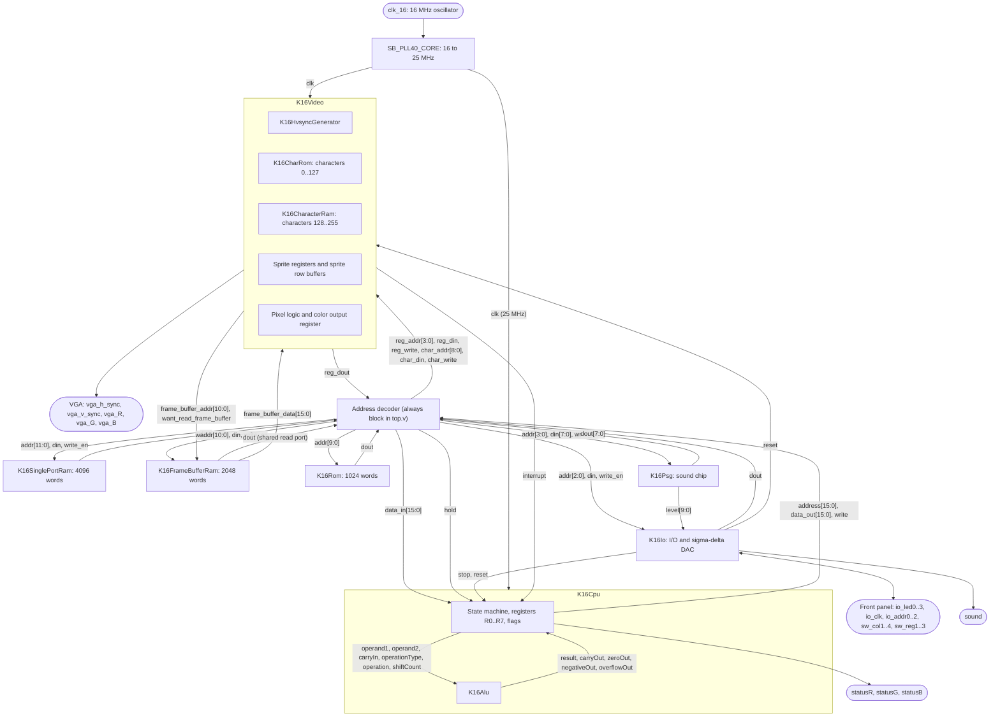

| Module | File | Interface | Task |
|---|---|---|---|
| `K16Computer` | `top.v` | the board pins | Top level: PLL, address decoder, and the sharing of the frame buffer read port. |
| `K16Cpu` | `K16Cpu.v` | `clk`, `reset`, `stop`, `interrupt`, `hold`; `address[15:0]`, `data_in[15:0]`, `data_out[15:0]`, `write`; `busy`, `statusR/G/B` | The CPU: one state machine for fetch, decode, execute, interrupt entry, and the front panel commands. |
| `K16Alu` | `K16Alu.v` | `operand1`, `operand2`, `carryIn`, `operationType[1:0]`, `operation[2:0]`, `shiftCount[2:0]`; `result`, `carryOut`, `zeroOut`, `negativeOut`, `overflowOut` | Combinational ALU: arithmetic, logic, shifts and rotations by 1 .. 8, and the byte loads. |
| `K16Video` | `K16Video.v` | `clk`, `reset`; `frame_buffer_addr`, `want_read_frame_buffer`, `frame_buffer_data`; `reg_addr`, `reg_din`, `reg_write`, `reg_dout`; `char_addr`, `char_din`, `char_write`; `interrupt`, `hsync`, `vsync`, `vga_R/G/B` | 640 x 480 VGA: characters and pixel blocks from the frame buffer, 8 sprites, the vertical blanking interrupt. |
| `K16HvsyncGenerator` | `K16HvsyncGenerator.v` | `clk`; `hpos`, `vpos`, `display_on`, `vga_h_sync`, `vga_v_sync` | 800 x 525 counters and the sync pulses. |
| `K16CharRom` | `K16CharRom.v` | `character[6:0]`, `line`; `bits[7:0]` | The fixed font, characters 0 .. 127. |
| `K16CharacterRam` | `K16Ram.v` | write port for the CPU, read port for the video | Characters 128 .. 255 (block RAM); at power-up the logo tiles of the start screen. |
| `K16FrameBufferRam` | `K16Ram.v` | write port for the CPU, one read port for video and CPU | 2048 words: text, pixel blocks, sprite images; at power-up the start screen. |
| `K16SinglePortRam` | `K16Ram.v` | `addr[11:0]`, `din`, `write_en`, `dout` | The 4096-word RAM with the default program. |
| `K16Rom` | `K16Rom.v` | `addr[9:0]`, `dout` | The 1024-word ROM library (generated from `K16Rom.asm`). |
| `K16Io` | `K16Io.v` | `addr[2:0]`, `din`, `write_en`, `dout`; panel pins; `psg_level[9:0]`; `stop`, `reset`, `sound` | Front panel scanning (switches and LEDs), clock counter, sound divider, the sigma-delta DAC for the sound pin (sound chip plus square wave), and the STOP and RESET keys. |
| `K16Psg` | `K16Psg.v` | `addr[3:0]`, `din[7:0]`, `write_en`, `dout[7:0]`; `level[9:0]` | The sound chip like the AY-3-8910: three tone channels, noise, mixer, volume, envelope; `level` is the sum of the channels (0 .. 765). |

All block RAMs have a registered output: the data of an address appears one clock after the address. This is why the CPU has a wait state after every memory address it sets.

### Memory map and address decoder

| Address | Decoder pattern | Device |
|---|---|---|
| `0x0000 .. 0x0FFF` | `0000 xxxx xxxx xxxx` | RAM; `0x0FFF` holds the interrupt vector |
| `0x8000 .. 0x87FF` | `1000 0xxx xxxx xxxx` | Frame buffer (`0x8600 .. 0x87FF` are the sprite images) |
| `0x8800 .. 0x89FF` | `1000 100x xxxx xxxx` | Changeable characters, write only |
| `0xF000 .. 0xF3FF` | `1111 00xx xxxx xxxx` | ROM |
| `0xFFD0 .. 0xFFDF` | `1111 1111 1101 xxxx` | Sound chip registers R0 .. R15 (R14, R15 read 0) |
| `0xFFE8 .. 0xFFF7` | `1111 1111 1110 1xxx`, `1111 1111 1111 0xxx` | Sprite registers |
| `0xFFF8 .. 0xFFFF` | `1111 1111 1111 1xxx` | I/O: address switches, control switches, address LEDs, data LEDs, register switches, counter high, counter low, sound |
| all others | | read as `0x9FFF` (HLT), writes are ignored |

The frame buffer has only one read port. The video uses it for 2 of every 16 clocks to fetch a character, and during the horizontal blanking for the sprite rows. In the other clocks the CPU can read. When the CPU reads the frame buffer while the data is not valid, the decoder sets `hold`, and the CPU waits.

## CPU state machine

### Conditions before the state machine

The `always` block of `K16Cpu` checks these conditions first. Each of them replaces the state machine for one clock:

| Condition | Effect |
|---|---|
| `reset` | `state ← RESET`, `running ← 0`, `key_valid ← 1` |
| `stop` | `running ← 0`, `key_valid ← 1`; the CPU finishes the instruction and then goes to the front panel |
| `interrupt && enableInterrupt` | `handleInterrupt ← 1`; the state machine waits one clock |
| `hold` | the state machine waits (frame buffer data not valid yet) |

### Fetch, decode, and interrupt entry

Every instruction starts with the same three clocks. `FETCH_INSTR` puts the PC on the address bus and lets the ALU calculate PC + 1, `WAIT_INSTR` waits for the memory and stores the new PC, and `DECODE_INSTR` decodes `data_in` and prepares the ALU for the instruction.

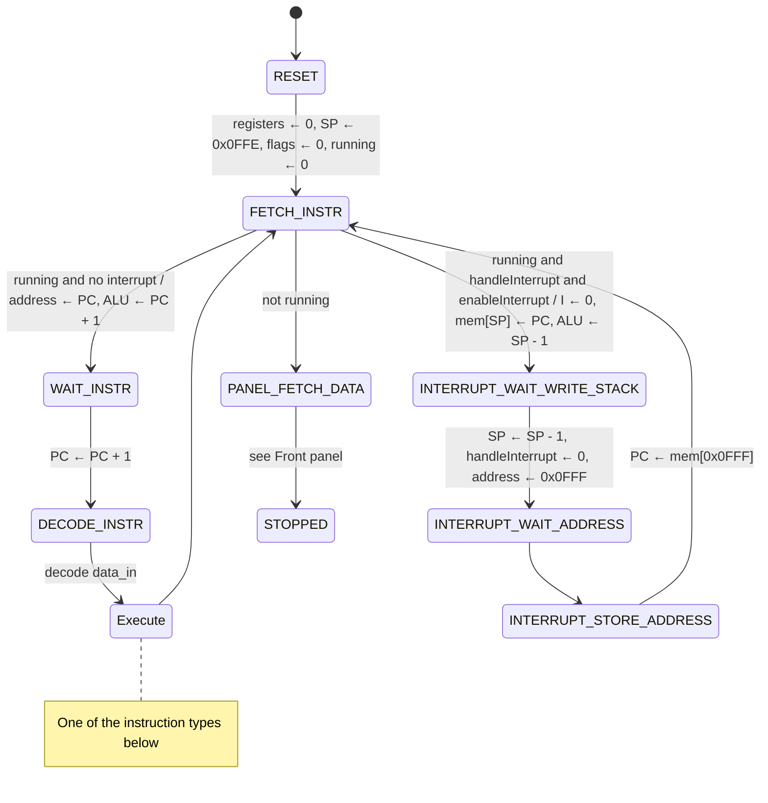

The interrupt entry takes 4 clocks. It saves only the PC; the handler saves the flags with PSF and returns with RTI.

### ALU instructions: ADD, ADC, SUB, SBC, AND, OR, XOR, NOT

`000 ddd sss ttt 0ooo`. ADD, ADC, SUB, and SBC also set C and O; AND, OR, XOR, and NOT only Z and N. 4 clocks.

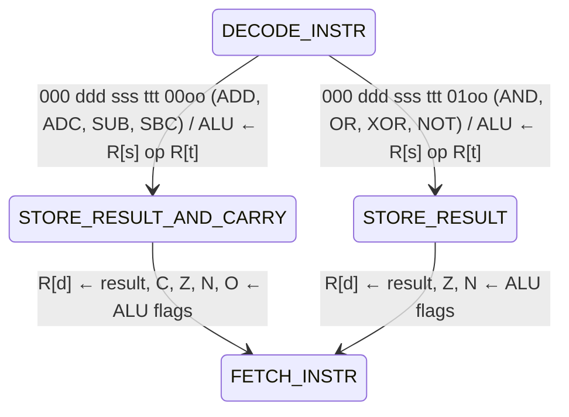

### Shift instructions: SHR, SHL, ASHR, ROR, ROL

`001 ddd sss nnn 0ooo`, shift by `nnn + 1` (1 .. 8) bits. C is the last bit shifted out; ROR and ROL rotate the 17 bits of C and the register. O is not changed. 4 clocks.

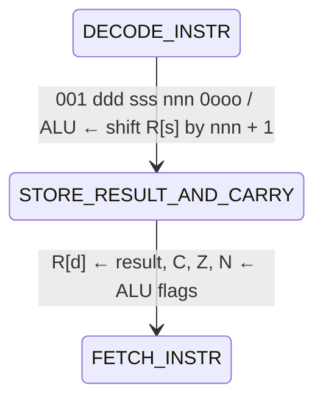

### Register loads, immediate loads, INC, DEC

- **Register loads:** `000 ddd sss xxx 10oo` (LD, LDL, LDH, SWP).
- **Immediate loads:** `011 ddd oo iiiiiiii` (LDL, LDH, LDLZ, LDHZ).
- **INC and DEC:** `000 ddd sss nnn 11oo`, with `nnn + 1` as the step (1 .. 8).

All of them set Z and N and take 4 clocks.

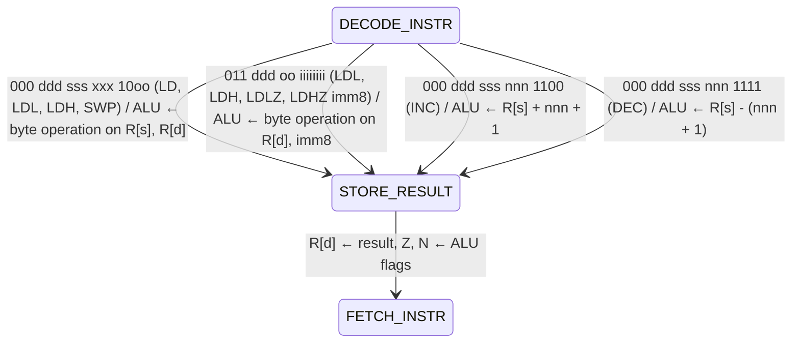

### CMP

`000 xxx sss ttt 1110`: the flags of R[s] - R[t], without storing the result. 4 clocks.

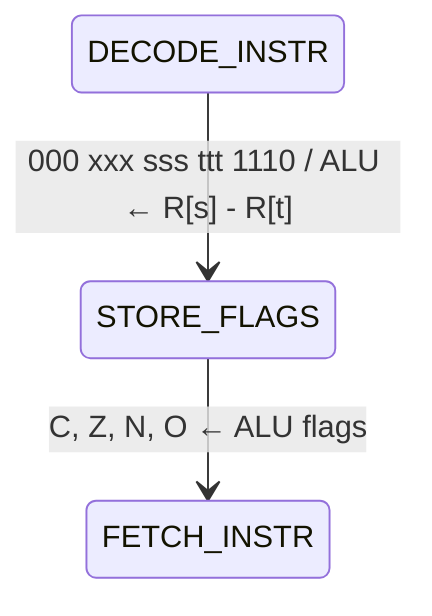

### Flag instructions: CLC, SEC, CLI, SEI

`001 xxx xxx xxx 10oo`. Executed in the decode clock: 3 clocks.

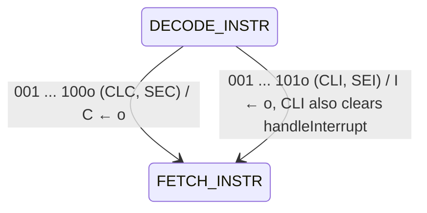

### Branches: BCS, BCC, BZS, BZC, BNS, BNC, BOS, BOC

`010 ccc bbb ooooooo`: if condition `ccc` is true, PC ← R[b] + offset7. 3 clocks if not taken, 4 if taken.

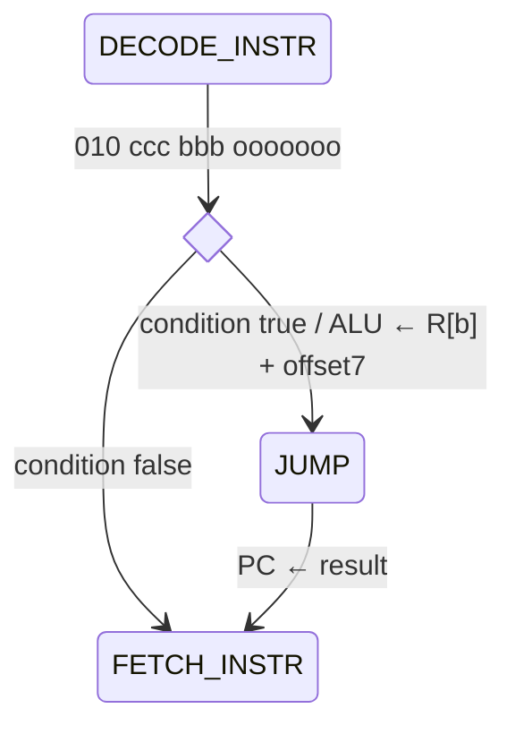

### JMP and JSR

- **JMP:** `100 bbb oooooooooo`, PC ← R[b] + offset10. 4 clocks.
- **JSR:** `101 bbb oooooooooo`, pushes the PC first. 5 clocks.

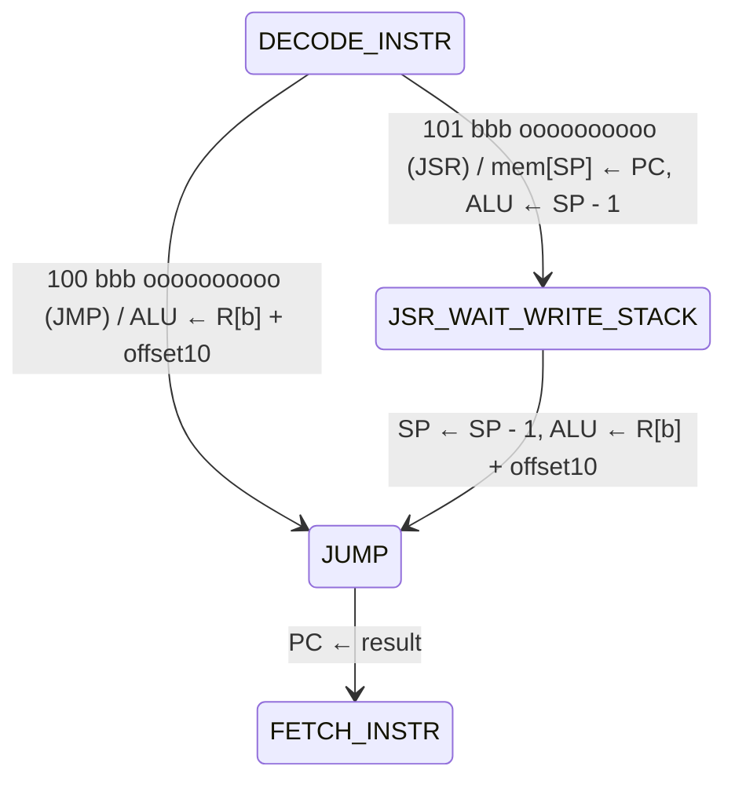

### HLT

`1001 1111 1111 1111` (JMP with all offset bits set). 3 clocks until the CPU is in the front panel loop.

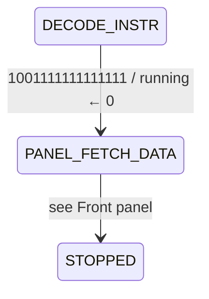

### LD and STO with memory

- **LD:** `110 ddd bbb ooooooo`, R[d] ← mem[R[b] + offset7], sets Z and N. 6 clocks.
- **STO:** `111 sss bbb ooooooo`, mem[R[b] + offset7] ← R[s]. 5 clocks.

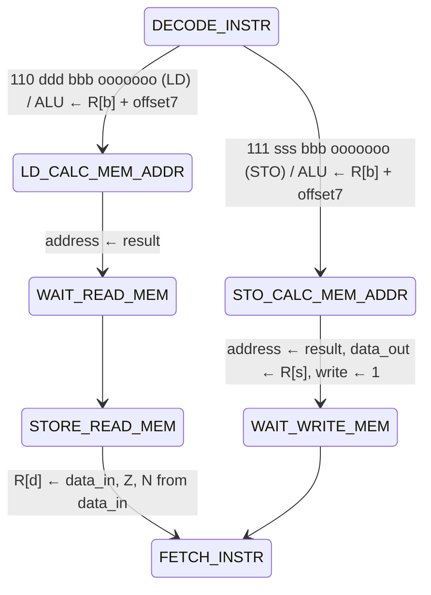

### Stack: PSH, PSF, POP, RET, RTI, POF

- **PSH and PSF:** `001 sss xxxxxx 1100` and `... 1110`, push a register or the flags. 4 clocks.
- **POP:** `001 ddd xxxxx0 1101`, sets Z and N. 6 clocks.
- **RET:** POP into the PC, `0x3C0D`. It also sets Z and N from the return address. 6 clocks.
- **RTI:** `0x3C1D`, POP into the PC with bit 4 set. It enables interrupts and leaves the flags unchanged. 6 clocks.
- **POF:** `001 xxx xxxxxx 1111`, pops the flags. 6 clocks.

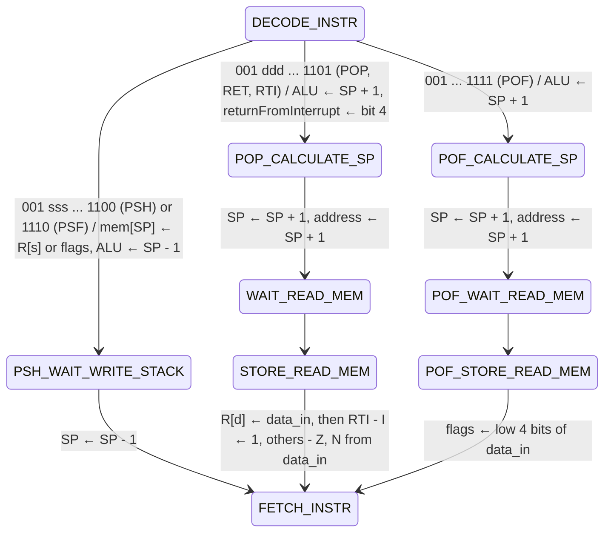

### Clock cycles

From one instruction fetch to the next, at 25 MHz (one clock = 40 ns). They are checked by `tests/K16CpuTiming_tb.v`.

| Instructions | Clocks |
|---|---|
| ADD, ADC, SUB, SBC, AND, OR, XOR, NOT, CMP | 4 |
| LD, LDL, LDH, SWP (registers), LDL, LDH, LDLZ, LDHZ (immediate), INC, DEC | 4 |
| SHR, SHL, ASHR, ROR, ROL (any count) | 4 |
| CLC, SEC, CLI, SEI | 3 |
| Branches | 3 if not taken, 4 if taken |
| JMP | 4 |
| JSR | 5 |
| LD from memory | 6 |
| STO | 5 |
| PSH, PSF | 4 |
| POP, POF, RET, RTI | 6 |
| HLT | 3 (until the CPU is in the front panel loop) |
| Interrupt entry | 4 |

**Extra clocks:**
- **Frame buffer reads:** a read waits while the video uses the read port (`hold`), up to 2 clocks.
- **Interrupt request:** the clock in which a request is latched adds one clock to the instruction that is running.

## Front panel

When the CPU is not running (after power-up, HLT, STOP, or a single step), it stays in a loop that reads the command and register switches (`0xFFFC`). Bits 6 .. 3 are the command key. `key_valid` makes sure that a key that is held down is executed only once: a new command is accepted after the switches showed no key (`NONE`). Each command ends by showing the data at `0xFFFB` (data LEDs) and the PC at `0xFFFA` (address LEDs).

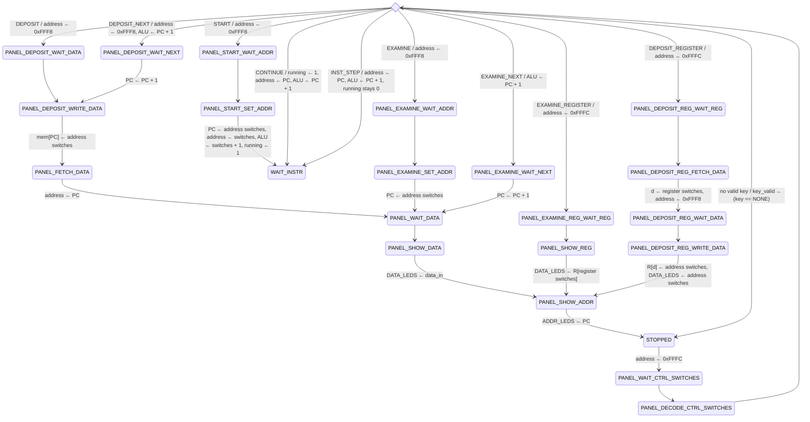

- **Single step:** INST_STEP runs one instruction with `running` still 0, so the next `FETCH_INSTR` returns to `PANEL_FETCH_DATA`.
- **HLT:** it also goes to `PANEL_FETCH_DATA`, so the LEDs show the PC and the word there.
- **Unused state:** `PANEL_DEPOSIT_WAIT_WRITE_MEM` is declared in `K16Cpu.v` but never entered.
